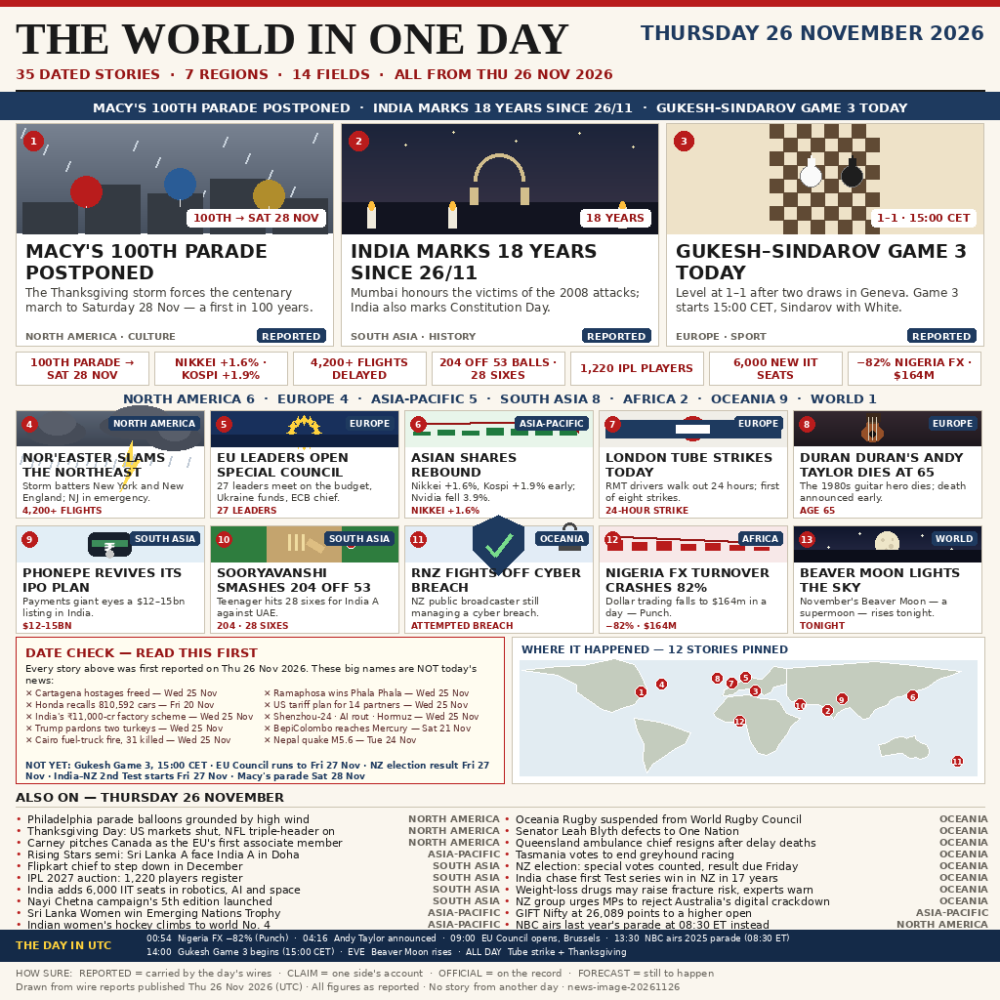

# The World in One Day — Thursday 26 November 2026

[](https://make.fun/bounty/news-image-20261126?utm_source=github&utm_medium=readme&utm_campaign=news-image-20261126)
[](https://make.fun/bounty/news-image-20261126/leaderboard?utm_source=github&utm_medium=readme&utm_campaign=news-image-20261126)
[](https://make.fun/bounty/news-image-20261126?utm_source=github&utm_medium=readme&utm_campaign=news-image-20261126)

One image that sums up the world's news of **Thursday 26 November 2026**:
**20 dated stories · 7 regions · 10 fields**, every one first reported that day.



## The day, in three lines

- **Macy's 100th Thanksgiving Day Parade postponed** to Saturday 28 November —
  the first postponement in the parade's 100-year history, forced by the
  nor'easter slamming the US Northeast on Thanksgiving Day.
- **India marks 18 years since the 26/11 Mumbai attacks**, and Constitution Day.
- **Gukesh–Sindarov Game 3** in Geneva, the world-title duel level at 1–1.

## How it is built

- `stories.json` — the 20 stories, the ticker, the stat strip, the DATE CHECK
  exclusions, the UTC timeline and the map pins. Every story carries its
  region, field and first-publication date.
- `render.py` — draws the whole front page with Pillow: masthead with the
  date claim, ticker, three hero cards, ten featured cards with drawn scenes,
  a stat strip, a region bar, a DATE CHECK box, a schematic world map with
  numbered pins, the also-on list, a UTC timeline and a certainty legend.
  Deterministic: run it twice and the PNG bytes are identical.
- `main.py` — the entrypoint. Standard library only: it copies the committed
  `entry.png` to `MAKEFUN_OUTPUT_DIR` and verifies the copy byte for byte.
  It runs under the grader's Python with no network and no Pillow.
- `entry.png` — the finished front page, 1024×1024, 184,823 bytes.

Run it:

```sh
python3 render.py            # rebuild entry.png from stories.json
MAKEFUN_OUTPUT_DIR=out python3 main.py   # grader-style run
```

## Date discipline

The date of **every** story was checked against wire and publisher reports
before it was drawn — not against headlines or roundups, which mostly
re-report the previous day. The image says so itself in its DATE CHECK box,
naming the big stories that are *not* 26 November and were left out:

Cartagena hostages freed (Wed 25 Nov) · the Cairo fuel-truck fire
(Wed 25 Nov) · Ramaphosa's Phala Phala win (Wed 25 Nov) · the US tariff
plan for 14 partners (Wed 25 Nov) · Shenzhou-24 and the AI rout
(Wed 25 Nov) · the PhonePe IPO revival, the IPL 1,220-player register,
the 6,000 new IIT seats, the RNZ cyber breach, the Flipkart chief's
exit and the Nayi Chetna launch (all Wed 25 Nov) · Sooryavanshi's 204
(Tue 24 Nov) · the ₹15,000-cr Nepal package and the India–NZ Test draw
(Mon 23 Nov) · the Sri Lanka Women Trophy win, South Africa's win over
Bangladesh, Blyth's defection, the failed Tasmanian greyhound bill and
the grounded Philly parade balloons (all Wed 25 Nov) · Carney's EU
associate-member bid (Sep 2026) · Oceania Rugby's suspension
(Wed 19 Nov).

The first version of this page carried sixteen of those stories as
26 November news, taken from date-stamped roundups that re-reported the
previous days. Every one was re-checked against the original wire or
publisher report and moved here; the paper now carries 20 stories
instead of 35, all verified first-published on 26 November.

Items still to happen that day are marked FORECAST or listed under
"NOT YET" (Gukesh Game 3 at 15:00 CET, the EU Council running to Friday,
the New Zealand election result, the Macy's parade on Saturday).

Sources consulted include Reuters, AP, the Press Association, Punch
(Nigeria), RNZ, ABC News, the Consilium, Macy's/NBC, FIDE, KCNA via
Reuters, AAP/The Courier-Mail (Queensland), the ICC Rising Stars
bulletin, CBS News and ANI. Figures are
as reported; claims are labelled REPORTED, never presented as confirmed
where only one side has spoken.

The map is schematic: pins are spread slightly where four European stories
share a few degrees of longitude, so every number stays readable.

## License

MIT — see [LICENSE](LICENSE).
